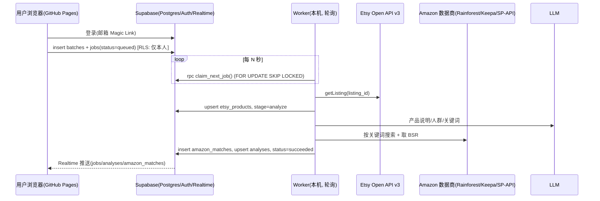
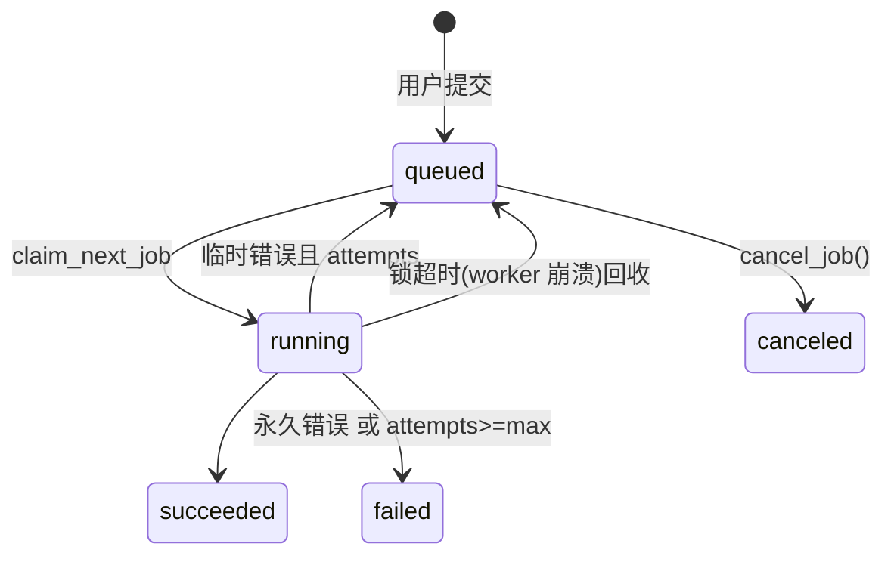

# Etsy → Amazon US 选品分析系统 架构设计

## 1. 目标
在网页上粘贴 Etsy 商品链接 → 系统逐条处理：识别产品是什么、目标人群、候选亚马逊搜索词 → 在亚马逊美国站找同款/相似款 → 评估竞争与销量 → 网页表格实时展示结果。

## 2. 分层
| 层 | 技术 | 职责 |
|---|---|---|
| 前端 | GitHub Pages 静态站（HTML + 原生 JS + supabase-js） | 登录、提交链接、实时结果表 |
| 数据/鉴权 | Supabase（Postgres + Auth + RLS + Realtime） | 存储、任务队列、权限隔离、推送更新 |
| Worker | 本机 Linux（Python，systemd 常驻） | **主动轮询**队列，调用外部 API，写回结果。无入站端口 |
| 数据源 Provider（可插拔） | Etsy Open API v3；Amazon：Rainforest / Keepa / SP-API；LLM：OpenAI 兼容接口 | 外部数据与分析 |

本机不可公网访问，因此不使用 webhook / Edge Function 回调本机；worker 只做出站 HTTPS 请求（Supabase REST + 各 API）。

## 3. 数据流

## 4. 任务状态机

`running` 内部子阶段 `stage`: fetch_etsy → analyze → search_amazon → score → done。

## 5. Supabase 表结构（见 `supabase/migrations/001_init.sql`、`002_cancel_job_invoker.sql`）
- `batches`：一次提交（user_id, name）
- `jobs`：队列 + 状态（etsy_url, etsy_listing_id, status, stage, attempts, max_attempts, error, locked_by/at, run_after）
- `etsy_products`：Etsy 原始数据（标题、描述、价格、tags、材质、店铺、收藏数、raw jsonb）
- `analyses`：分析结论（产品说明、类目、目标人群、关键词、competition/demand、机会分 0-100、结论）
- `amazon_matches`：亚马逊候选（ASIN、标题、价格、评分、评论数、BSR、**估算**月销、相似度、provider）
- 函数：`claim_next_job(worker)`（仅 service_role，含锁超时回收）、`cancel_job(id)`（用户）
- 迁移 002：按 Supabase 安全顾问(lint 0029)把 `cancel_job` 改为 SECURITY INVOKER；收回 authenticated 对 jobs 的整表 UPDATE，仅授予 `status, finished_at` 列级权限，并加 `jobs_cancel` 策略（只能把自己 queued 的任务改为 canceled）
- Realtime：jobs / analyses / amazon_matches 加入 `supabase_realtime` 发布

## 6. 安全 / RLS
- 前端只用 **anon key**（公开安全）；所有表开启 RLS：用户只能 select 自己的行，只能 insert 自己的 batch/job（且必须 status=queued）。
- 用户只能通过 `jobs_cancel` 策略把自己排队中的任务取消（迁移 002），不能改其它字段，也不能写结果表；结果只能由 worker 用 **service_role key**（绕过 RLS）写入。service_role key 只存在于本机 `.env`（权限 600），不进 Git、不进前端。
- `claim_next_job` 对 anon/authenticated 撤销执行权限。
- Supabase Auth：建议关闭公开注册，或只允许白名单邮箱（仅 Hongyan 自用），防止陌生人消耗 API 额度。
- 前端渲染全部 HTML 转义；URL 前后端都校验必须为 etsy.com/listing/数字。
- 不做任何验证码绕过，不爬 Etsy/Amazon 前台页面；仅使用官方/授权的数据接口。

## 7. 成本与所需密钥
| 项目 | 用途 | 费用（2026 年需以官网为准） |
|---|---|---|
| Supabase | DB/Auth/Realtime | 免费档足够 MVP（注意免费项目 7 天无活动会暂停；worker 轮询可保活） |
| GitHub | 代码 + Pages | 免费（Pages 免费版要求公开仓库，或付费计划用私有仓库） |
| Etsy Open API v3 | 商品数据 | 免费，需申请 App 获取 keystring（审核中） |
| Rainforest API | 亚马逊搜索/商品/BSR | 按请求计费，约每 1000 次数十美元级；每个 Etsy 链接约 3 次搜索 + 3 次商品 ≈ 6 次 |
| Keepa（可选） | BSR 历史、销量估算更准 | 订阅制约 €19+/月 起 |
| SP-API（可选） | 官方 Catalog Items（BSR 在 salesRanks） | 免费，需卖家中心开发者注册/审核（Hongyan 是卖家，可申请） |
| LLM | 产品识别/关键词 | 每条约几千 token，便宜模型 < $0.01/条 |

## 8. Provider 设计
接口在 `worker/analyzer/providers/base.py`：
- `EtsyProvider.get_listing(listing_id)` → mock / `etsy_api`（已实现，待 key 验证）
- `AmazonProvider.search(keyword, limit)` → mock / `rainforest`（已实现，待 key 验证）/ `keepa`、`spapi`（待实现）
- `LLMProvider.analyze_product(p)`、`rank_similarity(p, items)` → mock / `openai_compat`（已实现）
通过环境变量切换，无需改代码。

**销量说明**：亚马逊不公开销量。系统用 BSR→月销量 幂律公式粗估（`scoring.py`，按类目校准前仅供排序），并结合评论数衡量竞争。接入 Keepa 后可改用其 monthlySold / 历史曲线。

## 9. 分阶段计划
1. **MVP（当前骨架）**：mock 全链路 + Supabase 表 + 前端表格 + 实时更新；拿到 Etsy key 后切 `etsy_api`；接 LLM。
2. **V1**：接 Rainforest（或 SP-API Catalog）真实亚马逊数据；BSR 估算按类目校准；失败重试与限流；成本计数。
3. **V2**：图像相似度（Etsy 图 vs 亚马逊主图，多模态 LLM）；Keepa 历史趋势；结果导出 CSV；批次视图/筛选/排序。
4. **完整版**：多 worker 并发（SKIP LOCKED 已支持）、缓存同关键词结果、每日额度上限、报表与告警。

## 10. 风险
- Etsy API key 审核未过/限流（默认 10 QPS、每日 10k）→ 可暂时手动录入产品信息兜底。
- 亚马逊数据商价格/稳定性/条款变化 → provider 可插拔，可切换。
- 销量是估算值，误差大 → 前端明确标注“估算”。
- LLM 关键词偏差 → 保留人工编辑关键词并重跑的功能（V1）。
- 本机宕机 → systemd 自动重启；锁超时回收未完成任务。
- Supabase 免费项目暂停、service_role key 泄露 → key 只存本机，定期轮换。

## 11. 证据与决策过程（迁移 003/004）
- `analyses.audience_evidence`：`{source: reviews|listing_text, reviews_analyzed, listing_fields_used, method, signals[{signal,count,audience}], evidence[{quote,rating,signal}]}`。真实模式评论来自 Etsy Open API v3 `getReviewsByListing`，无评论时回退 `getReviewsByShop`；仍无则明确标注“依据商品文字推断”。LLM 引用的评论会校验是否为原文，计数由确定性规则计算，防止编造。
- `analyses.decision_trace`：7 步 `[{step,title,input,output,reasoning}]`：识别产品 → 判断人群 → 生成搜索词 → 亚马逊搜索 → 匹配同款/类似 → 竞争与销量评估 → 结论。
- `evidence_snapshots`：每条证据一行，`kind ∈ identical(同款) / similar(类似品) / search_result(关键词搜索页)`，含关键词、来源 URL、标题、价格、BSR、评论数、相似理由、图片路径。数量默认不限（`MAX_SNAPSHOTS_PER_KIND`）。
- `amazon_matches.match_type / similarity_reason`：相似度 ≥0.55 同款，≥0.2 类似品，其余丢弃。
- Storage：私有 bucket `snapshots`，路径 `{user_id}/{job_id}/NNN_kind.ext`；RLS 仅允许本人读取自己目录，前端用 1 小时 signed URL；只有 worker(service_role) 写入。
- 截图 provider（`SCREENSHOT_PROVIDER`）：`mock` 生成 SVG 占位图；`product_image` 下载数据商返回的商品主图，搜索页生成“数据摘要卡”（标注非截图）；`screenshot_api` 调第三方截图服务，失败回退。亚马逊会对自动访问出验证码，本系统不做任何绕过。

## 12. 评论数量规则（MIN_REVIEWS）
- 每个商品至少分析 `MIN_REVIEWS`（默认 50）条**本商品**评论；商品总评论不足 50 条时全部使用。
- 真实模式：`getReviewsByListing` 以 `limit=100, offset` 分页，直到已取 ≥ MIN_REVIEWS 或取完（按接口返回的 `count` 判断）。因按整页取，实际分析数可能多于 50（如共 120 条时分析 100 条）。无文字的纯星级评论不计入。
- 同店补充（`SUPPLEMENT_SHOP_REVIEWS`，**默认关闭**）：本商品评论不足时，可用 `getReviewsByShop` 的同店其它商品评论补足到 MIN_REVIEWS。决定默认关闭，因为它们评价的是别的商品，会污染人群判断；开启时每条评论带 `source=shop`，依据中分开计数并在引用上标“同店补充”。
- `audience_evidence` 新增：`min_reviews, listing_reviews_total, listing_reviews_used, shop_reviews_used, shop_reviews_total, shop_supplement_enabled`；前端显示“分析了 N 条评论（商品共 M 条）”。
- LLM 处理 50+ 条：map-reduce，每批 ≤40 条抽取信号与原文引用（引用逐条校验为原文），合并计数后再做一次总结生成人群与搜索词；评论数量统计由代码计算，不由 LLM 给出。

## 13. Keepa provider（AMAZON_PROVIDER=keepa）
- `/search?type=product&asins-only=1` 取关键词 ASIN（每关键词最多 `KEEPA_RESULTS_PER_KEYWORD`，默认 10）→ `/product?asin=…&stats=90` 每批 ≤100 个 ASIN 取详情。
- 字段：价格 stats.current[18]/[0]/[1]（美分）；BSR current[3]；评分 current[16]/10；评论 current[17]；图片 images[].l / imagesCSV → `https://m.media-amazon.com/images/I/<id>`。
- 销量：优先 `monthlySold`（亚马逊“过去一月购买 X+”，真实信号），缺失才用 BSR 估算；决策过程中注明各自数量。
- Token：每次响应记录 tokensConsumed/tokensLeft/refillRate，每个任务的消耗写入决策过程“亚马逊搜索”步骤；429 时每 60 秒重试，最多等 10 分钟。
- 证据图：配合 `SCREENSHOT_PROVIDER=product_image` 使用 Keepa 商品主图；搜索页为“数据摘要卡”（非截图）。

## 14. Keepamore provider（当前生产使用，AMAZON_PROVIDER=keepamore）
- 第三方 HTTP API，封装 Keepa 数据与 ABA 关键词数据；base `https://mcp.keepamore.com/api`，请求头 `X-API-Key`（km_ 开头），超时 ≥180s，限速 20 次/分钟（429 时 15 秒退避重试）。
- 每关键词：`/productsearch`（5 units，亚马逊自然排序，排除广告）→ 前 `KEEPAMORE_RESULTS_PER_KEYWORD`（默认 10）个 ASIN → `/product?rating=1&history=false&stats=90`（1 unit/ASIN，补评分/评论数）。
- 每任务约 3×(5+10)=45 units；每次调用的 unitsConsumed 与资源包剩余量写入决策过程“亚马逊搜索”步骤。
- 可扩展（未接入）：ABA `/aba/search`→`/aba/word/:id` 验证关键词搜索排名与 Top3 ASIN 点击/转化（各 1 unit）；`/aba/asin-reverse` 反查竞品关键词；`/graphimage` 价格历史图（1 unit）可做快照；Google Trends 趋势。
