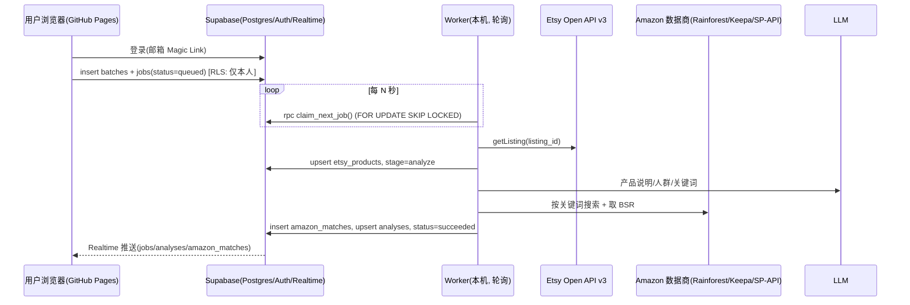
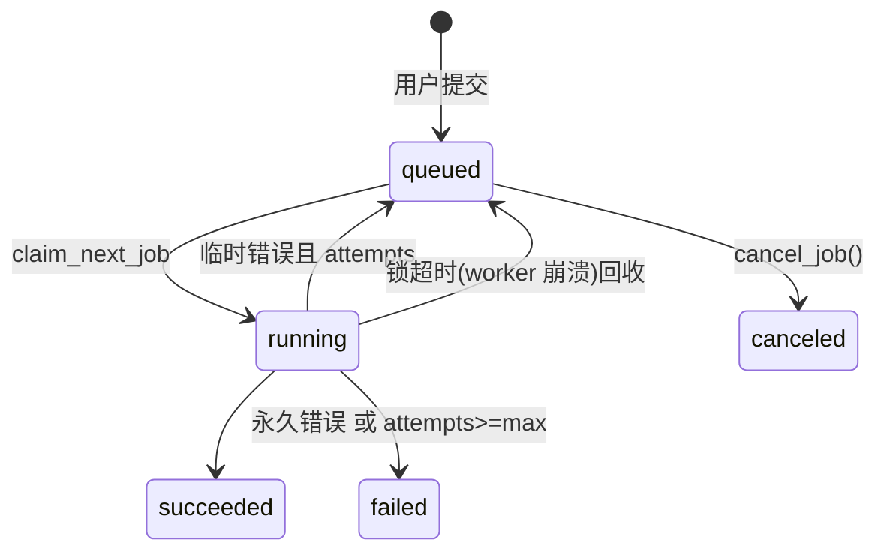

# Etsy → Amazon US 选品分析系统 架构设计

## 1. 目标
在网页上粘贴 Etsy 商品链接 → 系统逐条处理：识别产品是什么、目标人群、候选亚马逊搜索词 → 在亚马逊美国站找同款/相似款 → 评估竞争与销量 → 网页表格实时展示结果。

## 2. 分层
| 层 | 技术 | 职责 |
|---|---|---|
| 前端 | GitHub Pages 静态站（HTML + 原生 JS + supabase-js） | 登录、提交链接、实时结果表 |
| 数据/鉴权 | Supabase（Postgres + Auth + RLS + Realtime） | 存储、任务队列、权限隔离、推送更新 |
| Worker | 阿里云 ECS 47.98.137.124（Python venv，systemd `etsy-analyzer-worker` 常驻，见 §15） | **主动轮询**队列，调用外部 API，写回结果。无入站端口 |
| 数据源 Provider（可插拔） | Etsy Open API v3；Amazon：Rainforest / Keepa / SP-API；LLM：OpenAI 兼容接口 | 外部数据与分析 |

本机不可公网访问，因此不使用 webhook / Edge Function 回调本机；worker 只做出站 HTTPS 请求（Supabase REST + 各 API）。

## 3. 数据流

## 4. 任务状态机

`running` 内部子阶段 `stage`: fetch_etsy → analyze → search_amazon → score → done。

## 5. Supabase 表结构（见 `supabase/migrations/001_init.sql`、`002_cancel_job_invoker.sql`）
- `batches`：一次提交（user_id, name）
- `jobs`：队列 + 状态（etsy_url, etsy_listing_id, status, stage, attempts, max_attempts, error, locked_by/at, run_after）
- `etsy_products`：Etsy 原始数据（标题、描述、价格、tags、材质、店铺、收藏数、raw jsonb）
- `analyses`：分析结论（产品说明、类目、目标人群、关键词、competition/demand、机会分 0-100、结论）
- `amazon_matches`：亚马逊候选（ASIN、标题、价格、评分、评论数、BSR、**估算**月销、相似度、provider）
- 函数：`claim_next_job(worker)`（仅 service_role，含锁超时回收）、`cancel_job(id)`（用户）
- 迁移 002：按 Supabase 安全顾问(lint 0029)把 `cancel_job` 改为 SECURITY INVOKER；收回 authenticated 对 jobs 的整表 UPDATE，仅授予 `status, finished_at` 列级权限，并加 `jobs_cancel` 策略（只能把自己 queued 的任务改为 canceled）
- Realtime：jobs / analyses / amazon_matches 加入 `supabase_realtime` 发布

## 6. 安全 / RLS
- 前端只用 **anon key**（公开安全）；所有表开启 RLS：用户只能 select 自己的行，只能 insert 自己的 batch/job（且必须 status=queued）。
- 用户只能通过 `jobs_cancel` 策略把自己排队中的任务取消（迁移 002），不能改其它字段，也不能写结果表；结果只能由 worker 用 **service_role key**（绕过 RLS）写入。service_role key 只存在于本机 `.env`（权限 600），不进 Git、不进前端。
- `claim_next_job` 对 anon/authenticated 撤销执行权限。
- Supabase Auth：建议关闭公开注册，或只允许白名单邮箱（仅 Hongyan 自用），防止陌生人消耗 API 额度。
- 前端渲染全部 HTML 转义；URL 前后端都校验必须为 etsy.com/listing/数字。
- 不做任何验证码绕过，不爬 Etsy/Amazon 前台页面；仅使用官方/授权的数据接口。

## 7. 成本与所需密钥
| 项目 | 用途 | 费用（2026 年需以官网为准） |
|---|---|---|
| Supabase | DB/Auth/Realtime | 免费档足够 MVP（注意免费项目 7 天无活动会暂停；worker 轮询可保活） |
| GitHub | 代码 + Pages | 免费（Pages 免费版要求公开仓库，或付费计划用私有仓库） |
| Etsy Open API v3 | 商品数据 | 免费，需申请 App 获取 keystring（审核中） |
| Rainforest API | 亚马逊搜索/商品/BSR | 按请求计费，约每 1000 次数十美元级；每个 Etsy 链接约 3 次搜索 + 3 次商品 ≈ 6 次 |
| Keepa（可选） | BSR 历史、销量估算更准 | 订阅制约 €19+/月 起 |
| SP-API（可选） | 官方 Catalog Items（BSR 在 salesRanks） | 免费，需卖家中心开发者注册/审核（Hongyan 是卖家，可申请） |
| LLM | 产品识别/关键词 | 每条约几千 token，便宜模型 < $0.01/条 |

## 8. Provider 设计
接口在 `worker/analyzer/providers/base.py`：
- `EtsyProvider.get_listing(listing_id)` → mock / `etsy_api`（已实现，待 key 验证）
- `AmazonProvider.search(keyword, limit)` → mock / `rainforest`（已实现，待 key 验证）/ `keepa`、`spapi`（待实现）
- `LLMProvider.analyze_product(p)`、`rank_similarity(p, items)` → mock / `openai_compat`（已实现）
通过环境变量切换，无需改代码。

**销量说明**：亚马逊不公开销量。系统用 BSR→月销量 幂律公式粗估（`scoring.py`，按类目校准前仅供排序），并结合评论数衡量竞争。接入 Keepa 后可改用其 monthlySold / 历史曲线。

## 9. 分阶段计划
1. **MVP（当前骨架）**：mock 全链路 + Supabase 表 + 前端表格 + 实时更新；拿到 Etsy key 后切 `etsy_api`；接 LLM。
2. **V1**：接 Rainforest（或 SP-API Catalog）真实亚马逊数据；BSR 估算按类目校准；失败重试与限流；成本计数。
3. **V2**：图像相似度（Etsy 图 vs 亚马逊主图，多模态 LLM）；Keepa 历史趋势；结果导出 CSV；批次视图/筛选/排序。
4. **完整版**：多 worker 并发（SKIP LOCKED 已支持）、缓存同关键词结果、每日额度上限、报表与告警。

## 10. 风险
- Etsy API key 审核未过/限流（默认 10 QPS、每日 10k）→ 可暂时手动录入产品信息兜底。
- 亚马逊数据商价格/稳定性/条款变化 → provider 可插拔，可切换。
- 销量是估算值，误差大 → 前端明确标注“估算”。
- LLM 关键词偏差 → 保留人工编辑关键词并重跑的功能（V1）。
- 本机宕机 → systemd 自动重启；锁超时回收未完成任务。
- Supabase 免费项目暂停、service_role key 泄露 → key 只存本机，定期轮换。

## 11. 证据与决策过程（迁移 003/004）
- `analyses.audience_evidence`：`{source: reviews|listing_text, reviews_analyzed, listing_fields_used, method, signals[{signal,count,audience}], evidence[{quote,rating,signal}]}`。真实模式评论来自 Etsy Open API v3 `getReviewsByListing`，无评论时回退 `getReviewsByShop`；仍无则明确标注“依据商品文字推断”。LLM 引用的评论会校验是否为原文，计数由确定性规则计算，防止编造。
- `analyses.decision_trace`：7 步 `[{step,title,input,output,reasoning}]`：识别产品 → 判断人群 → 生成搜索词 → 亚马逊搜索 → 匹配同款/类似 → 竞争与销量评估 → 结论。
- `evidence_snapshots`：每条证据一行，`kind ∈ identical(同款) / similar(类似品) / search_result(关键词搜索页)`，含关键词、来源 URL、标题、价格、BSR、评论数、相似理由、图片路径。数量默认不限（`MAX_SNAPSHOTS_PER_KIND`）。
- `amazon_matches.match_type / similarity_reason`：相似度 ≥0.55 同款，≥0.2 类似品，其余丢弃。
- Storage：私有 bucket `snapshots`，路径 `{user_id}/{job_id}/NNN_kind.ext`；RLS 仅允许本人读取自己目录，前端用 1 小时 signed URL；只有 worker(service_role) 写入。
- 截图 provider（`SCREENSHOT_PROVIDER`）：`mock` 生成 SVG 占位图；`product_image` 下载数据商返回的商品主图，搜索页生成“数据摘要卡”（标注非截图）；`screenshot_api` 调第三方截图服务，失败回退。亚马逊会对自动访问出验证码，本系统不做任何绕过。

## 12. 评论数量规则（MIN_REVIEWS）
- 每个商品至少分析 `MIN_REVIEWS`（默认 50）条**本商品**评论；商品总评论不足 50 条时全部使用。
- 真实模式：`getReviewsByListing` 以 `limit=100, offset` 分页，直到已取 ≥ MIN_REVIEWS 或取完（按接口返回的 `count` 判断）。因按整页取，实际分析数可能多于 50（如共 120 条时分析 100 条）。无文字的纯星级评论不计入。
- 同店补充（`SUPPLEMENT_SHOP_REVIEWS`，**默认关闭**）：本商品评论不足时，可用 `getReviewsByShop` 的同店其它商品评论补足到 MIN_REVIEWS。决定默认关闭，因为它们评价的是别的商品，会污染人群判断；开启时每条评论带 `source=shop`，依据中分开计数并在引用上标“同店补充”。
- `audience_evidence` 新增：`min_reviews, listing_reviews_total, listing_reviews_used, shop_reviews_used, shop_reviews_total, shop_supplement_enabled`；前端显示“分析了 N 条评论（商品共 M 条）”。
- LLM 处理 50+ 条：map-reduce，每批 ≤40 条抽取信号与原文引用（引用逐条校验为原文），合并计数后再做一次总结生成人群与搜索词；评论数量统计由代码计算，不由 LLM 给出。

## 13. Keepa provider（AMAZON_PROVIDER=keepa）
- `/search?type=product&asins-only=1` 取关键词 ASIN（每关键词最多 `KEEPA_RESULTS_PER_KEYWORD`，默认 10）→ `/product?asin=…&stats=90` 每批 ≤100 个 ASIN 取详情。
- 字段：价格 stats.current[18]/[0]/[1]（美分）；BSR current[3]；评分 current[16]/10；评论 current[17]；图片 images[].l / imagesCSV → `https://m.media-amazon.com/images/I/<id>`。
- 销量：优先 `monthlySold`（亚马逊“过去一月购买 X+”，真实信号），缺失才用 BSR 估算；决策过程中注明各自数量。
- Token：每次响应记录 tokensConsumed/tokensLeft/refillRate，每个任务的消耗写入决策过程“亚马逊搜索”步骤；429 时每 60 秒重试，最多等 10 分钟。
- 证据图：配合 `SCREENSHOT_PROVIDER=product_image` 使用 Keepa 商品主图；搜索页为“数据摘要卡”（非截图）。

## 14. Keepamore provider（当前生产使用，AMAZON_PROVIDER=keepamore）
- 第三方 HTTP API，封装 Keepa 数据与 ABA 关键词数据；base `https://mcp.keepamore.com/api`，请求头 `X-API-Key`（km_ 开头），超时 ≥180s，限速 20 次/分钟（429 时 15 秒退避重试）。
- 每关键词：`/productsearch`（5 units，亚马逊自然排序，排除广告）→ 前 `KEEPAMORE_RESULTS_PER_KEYWORD`（默认 10）个 ASIN → `/product?rating=1&history=false&stats=90`（1 unit/ASIN，补评分/评论数）。
- 每任务约 3×(5+10)=45 units；每次调用的 unitsConsumed 与资源包剩余量写入决策过程“亚马逊搜索”步骤。
- 可扩展（未接入）：ABA `/aba/search`→`/aba/word/:id` 验证关键词搜索排名与 Top3 ASIN 点击/转化（各 1 unit）；`/aba/asin-reverse` 反查竞品关键词；`/graphimage` 价格历史图（1 unit）可做快照；Google Trends 趋势。

## 预筛选（016/017，分支 prescreen）
- 提交时勾选“先预筛选”→ jobs.prescreen=true。worker（claim_next_job_v2）只跑**取数段**：EHunt `POST /api/v1/items`（24h provider_cache 优先）→ 保存 etsy_products → status='screening'、screen_state='awaiting'。额度熔断照旧：取不到的留在队列，次日 UTC 0 点继续。
- 筛选页 `#/screen[/<batch_id>]`（web/js/screen.js）：screen_list() 读数据，每 50 条一批，大图 + 标题 + 价格，✕ 排除 / 撤销。一批的数据和图片都加载完就能确认；每批有自己的“分析剩余数据”按钮，底部另有一个覆盖全部已加载批次。
- screen_confirm(keep, reject)：保留的 → screen_state='kept' 重新排队；worker 从**库里**读已存的 EHunt 数据（0 次 EHunt 调用，熔断中也放行），继续 DeepSeek → Keepamore → 截图。排除的 → status='canceled'、screen_state='rejected'，之后不再产生任何调用。它们不进任务列表（task_jobs 只放行 kept 的预筛选任务），在筛选页“已排除”标签里可以 screen_restore() 恢复。
- 兼容：旧版 claim_next_job 跳过预筛选任务；新 worker 在 v2 不存在时自动回退旧版。演示：`?demo=1&screen=300#/screen`（`&sshot=loading|rejected|confirm|bottom`）。

## 15. 部署：Worker 运行在阿里云 ECS（2026-10-15 起）
- 主机：47.98.137.124（Ubuntu 26.04，2 vCPU / 1.6 GB + 1 GB swapfile），同机还有 `/opt/keyword-battle-worker`、`/opt/voc-worker`（PM2 管理的 node 进程），互不影响。
- 代码：`/opt/etsy-analyzer`（GitHub `main` 的 git clone，公开仓库直接 HTTPS 拉取）；venv `/opt/etsy-analyzer/.venv`（运行时只用标准库 + python-dotenv，无浏览器 / Pillow）。
- 配置：`/opt/etsy-analyzer/worker/.env`（chmod 600，不在 git 中；与 box 相同，但 `WORKER_ID=ecs-hz-worker`、`WORKER_CONCURRENCY=2`）。
- 服务：`/etc/systemd/system/etsy-analyzer-worker.service`，`Restart=always`、开机自启、`MemoryHigh=350M / MemoryMax=500M`，日志进 journald（`journalctl -u etsy-analyzer-worker -f`，journald 自动轮转）。
- 心跳：`worker_heartbeat.worker_id` 为 `ecs-hz-worker` / `ecs-hz-worker-2`。
- box 上的 worker 已停用：`deploy/.worker-disabled-on-box`（不入 git）存在时，`ensure-worker.sh`（/etc/profile.d 与 ~/.bashrc 钩子）和 `run-worker.sh` 都不会再启动 worker，保证全局只有一个 worker 消费队列。若要回切到 box：先 `systemctl disable --now etsy-analyzer-worker`，再删除该标记并运行 `deploy/ensure-worker.sh`。
- 更新流程：box 上的 `deploy/auto-sync.sh` 仍负责提交并推送 web/ 等改动（GitHub Pages）；检测到 `worker/` 代码变化且已推送后，自动调用 `deploy/deploy-server.sh`（经 paramiko 在 ECS 上 `git fetch && git reset --hard <origin/main>`，requirements 变化时重装依赖，然后 `systemctl restart`）。手动：`deploy/deploy-server.sh`；查看状态：`deploy/deploy-server.sh --status`。SSH 密钥 `/home/box/.ssh/aliyun_user.pem`（`ECS_HOST/ECS_USER/ECS_KEY` 可覆盖）。
- 每日备份循环（`etsy-analyzer-backup/scripts/backup-loop.sh`）仍留在 box 上。

## 按评论速度排序
- 产品库工具栏「按评论速度排序」：**只在点击时**取评论日期并计算（`web/js/velocity.js`），再点恢复原顺序；点击前不计算。
- 规格（近 6 个月，新→旧）：①连续性 = 有评论的月份数 0-6（主排序）②6 月新增 + 月均（次排序）③趋势 近 3 月 vs 前 3 月 ④新鲜度 距最近评论天数，>30 天标「停滞?」。卡片徽标悬停看明细；仅用于同类产品对比。
- 数据适配器：`loadReviewDates(sb, ids)` → Map<listing_id, 日期[]>，读 `listing_reviews`（019）。来源：`etsy_page`（真实浏览器抓取 Etsy 商品页，抓取端另行实现）、`screenshot`（用户上传截图 OCR，核对后写入）。EHunt 只有评论总数/周新增，不提供评论日期。
- 抓取状态 `listing_scrape_status`（ok/failed/pending）。failed 的商品：工具栏右上「⚠ 无法抓取 N」+ 侧栏「无法抓取」分区，可
  1. **上传评论截图**（多张，私有 bucket `review-shots`，路径 `<uid>/<listing>/…`，仅本人）→ `queue_review_ocr` 入队 → worker 本地 tesseract 识别日期（`Oct 13, 2026` / `2026年10月13日`）与总评论数、跨截图去重 → 前端显示识别结果供核对修改 → `confirm_review_dates` 写入 `listing_reviews(source='screenshot')`，排序中带「截图」标记；
  2. **手动填写（备用）**：近 6 月每月评论数 + 最近评论日期 → `save_manual_velocity`（`listing_review_manual`，source='manual'），带「手动」标记。
  抓取失败且两者都没有、或未抓取的，显示「无评论日期数据」并排在最后。
- 迁移 `019_listing_reviews.sql` 已应用（2026-10-15）。
- Worker OCR：`worker/analyzer/review_ocr.py`作为 worker 主进程的后台线程每 20s 处理队列（已安装 pytesseract 时默认启用，`REVIEW_OCR_ENABLED=0` 关闭；也可 `python -m analyzer.review_ocr`）。ECS 已安装依赖：`apt install tesseract-ocr tesseract-ocr-chi-sim`，`pip install pytesseract pillow`。测试：`tests/test_review_ocr.py`。
- 演示：`?demo=1#/library`（示例评论日期、两个抓取失败条目：一个已手动填写，另一个可上传截图模拟识别；一个未抓取）。
- 浏览器抓取结果入库：box 上 `tools/save_reviews.py`（见文件头用法；`--list-library` 列出产品库 listing）。
- **自动抓取（049）**：`product_library` AFTER INSERT 触发器 → `listing_scrape_status=pending`（ON CONFLICT DO NOTHING；除了失败重试，不重复抓取）；box 上独立进程 `worker/selection/review_scraper.py`（`deploy/box-selection-worker.sh reviews-start`，评论抓取优先：默认不因 EHunt 忙让路，选品 worker nice 10；每轮 ≤3 个；可选 `REVIEW_YIELD_TO_EHUNT=1` 恢复旧让路）→ `claim_review_scrapes` → 抓取 → `finish_review_scrape`（ok 替换 etsy_page/etsy_api 公共行；failed 记错误）。抓取方式：有 `ETSY_API_KEY` 用 Open API v3；否则（当前）有头 Chrome（自己的 profile `reviews-profile`，专用 Xvfb `:77` 自动启动）首页预热 → 商品页「View all reviews for this item」（只接受 item 弹窗，否则 failed「仅店铺评论」）→ Most recent → 每页 8 条，>200 天/20 页即停；商品间 30–60s、翻页 3–6s、每会话 30 页后冷却 20–30 分钟、403 暂停 30–60 分钟、每日 ≤60 个；显示不可用时不认领并暂停。2026-10-22 实测 3 个真实商品通过（直连无预热的 headless 会 403）。本地端到端：`supabase/tests/e2e_049_local.sh dryrun.json`。ECS 访问不到 etsy.com，所以不放在 analyzer。前端卡片：pending/fetching「评论抓取中」，failed「抓取失败 重试」（`retry_review_scrape`），有抓取中的每 30s 刷新状态。测试：`worker/tests/test_review_scraper.py`、`supabase/tests/run_049_local.sh`、`web/tests/autoreviews.test.mjs`。
- **手动抓取评论速度（054，预览）**：产品库顶栏按钮「手动抓取评论速度」→ RPC `queue_library_review_scrapes(p_listings)` 把本人库里 failed / 无状态行置回 pending（有勾选则只排所选；`ok` 永不重抓；`fetching` 不动）；toast 显示排队数；前端查 `worker_heartbeat.worker_id=box-reviews`（review_scraper 每轮心跳），未运行则 toast「评论抓取进程未运行，已排队，进程起来后会抓」。点完可离开页面。测试：`supabase/tests/run_054_local.sh`、`web/tests/manualreviews.test.mjs`。演示：`?demo=1&nfails=8#/library`（8 个无法抓取）。
- **评论抓取进度条（预览）**：产品库「手动抓取评论速度」旁，客户端聚合 `listing_scrape_status`（本人库 listing：pending+fetching+ok+failed）→ 「评论抓取 已完成 A / 合计 B（排队 C · 进行中 D · 失败 E）」+ A/B 条；仅当有 pending/fetching 时显示，否则折叠。与卡片徽标同用 ~30s `scheduleScrapePoll` 刷新。无新迁移。测试：`web/tests/reviewsprogress.test.mjs`。演示：`?demo=1&revprog=1#/library`（演示数字 12/30）。
- **产品库「删除产品」直接删除（055，预览）**：卡片 / 批量「删除产品」（原「移出产品库」文案）→ 确认「删除不可恢复」→ RPC `delete_library_items` 删除 `product_library` 行 **并** 删除本人对应 listing 的非运行中任务（分析/匹配/截图 cascade）；**不**回到「我的任务」。`listing_scrape_status` / `listing_reviews` 保留（按 listing_id、无 FK，再加入可复用）。「加入后撤销」仍用 `remove_from_library`（只移出库、任务回列表）。`delete_rejected_library` 同步走同一删除语义（返回 jsonb）。测试：`supabase/tests/run_055_local.sh`、`web/tests/libdel.test.mjs`。演示：`?demo=1&libdel=1#/library`（确认框文案）。
- **评论抓取防拦截冷却提示（预览）**：会话页数冷却 / 反爬暂停时，`review_scraper` 经 `cool_heartbeat_info` 把 `cool_until`（UTC）与 `cool_remaining_s` 写入 `worker_heartbeat.info`（`worker_id=box-reviews`）；产品库进度条读该心跳，附加「防拦截冷却中，约 N 分钟后继续」。冷却中也轮询刷新剩余分钟。无新迁移。测试：`worker/tests/test_review_scraper.py`（cool heartbeat）、`web/tests/reviewsprogress.test.mjs`。演示：`?demo=1&revprog=1&revcool=23#/library`（演示数字约 23 分钟）。

## 一键亚马逊搜索（PM-001，迁移 020）
- `analyses.keyword_items` / `product_library.amazon_keywords`：`[{keyword, source, basis}]`，source ∈ title/image/review/original-title/manual，≤5 个，去重（约束 `valid_amazon_keywords`）；恰好 1 个 original-title（原标题逐字片段，≤4 词）。
- 生成：DeepSeek 分析（REDUCE_PROMPT 的 `amazon_keywords` 字段）→ `analyzer/amazon_keywords.build()` 校验/去重/兜底；`add_to_library` 入库时复制，人工编辑过（`keywords_edited_at`）的不覆盖。DeepSeek 不能看图：只用流水线已有的图片描述（`raw.image_description` 等，目前没有）。
- 编辑：RPC `update_library_keywords(p_item, p_keywords)`，新增词强制 manual。`library_page` 多返回 `amazon_keywords`、`competitor_asin`（关联任务里相似度最高的同款 ASIN）。
- 前端 `web/js/amzsearch.js`：仅 candidate/active 显示按钮；点击时同步 `window.open` 每词一个 `amazon.com/s?k=`，返回 null 计为被拦截并提示；竞品 ASIN 勾选默认关。测试 `node --test web/tests/`。
- 回填：`tools/backfill_amazon_keywords.py [--dry-run] [--rebuild]`。
- 五个方向（021）：每个词带 `direction` 1-5（D1 精准词 必有且唯一 / D2 同场景相似品 / D3 产品文案（必须逐字出现在标题或豆包读出的 text_on_product 里，品牌词丢弃）/ D4 人群礼物词 / D5 细分场景词）。`build()` 输出 D1 → 每方向 1 个 → 同方向补满 ≤5。旧的 original-title 槽位取消。
- 豆包视觉（`providers/doubao_vision.py`）：Ark `https://ark.cn-beijing.volces.com/api/v3/chat/completions`，模型 `DOUBAO_VISION_MODEL`（默认 doubao-seed-2-1-turbo-260628，本账号唯一已开通的；vision-pro / seed-1-6-vision 不可用）。`DOUBAO_VISION_ENABLED=1` + `ARK_API_KEY` 才启用；`DOUBAO_VISION_MODE=always`（默认，读 D3 文案）| `unclear`（仅标题不清楚时）。主图取 EHunt 已有 image_url。任何失败 → None，回退仅标题，不影响分析。约 1.5k tokens/张，约 ¥0.006/产品。
